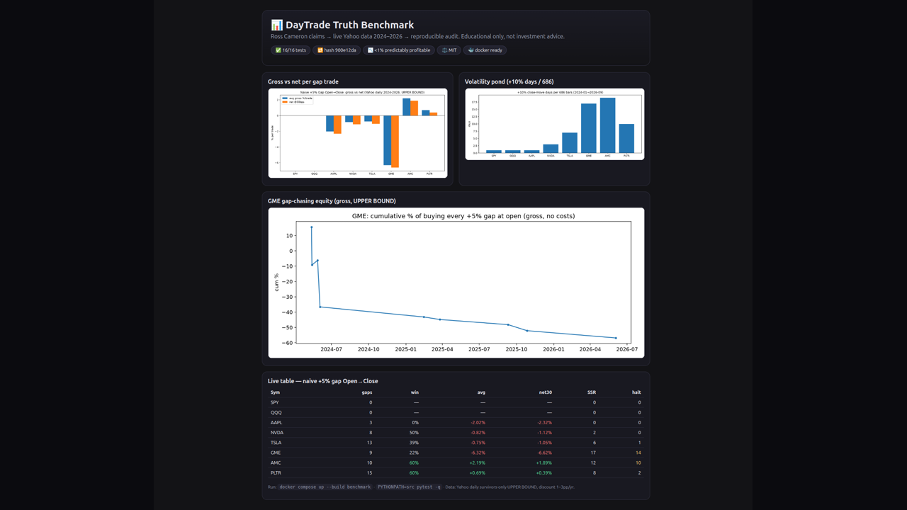
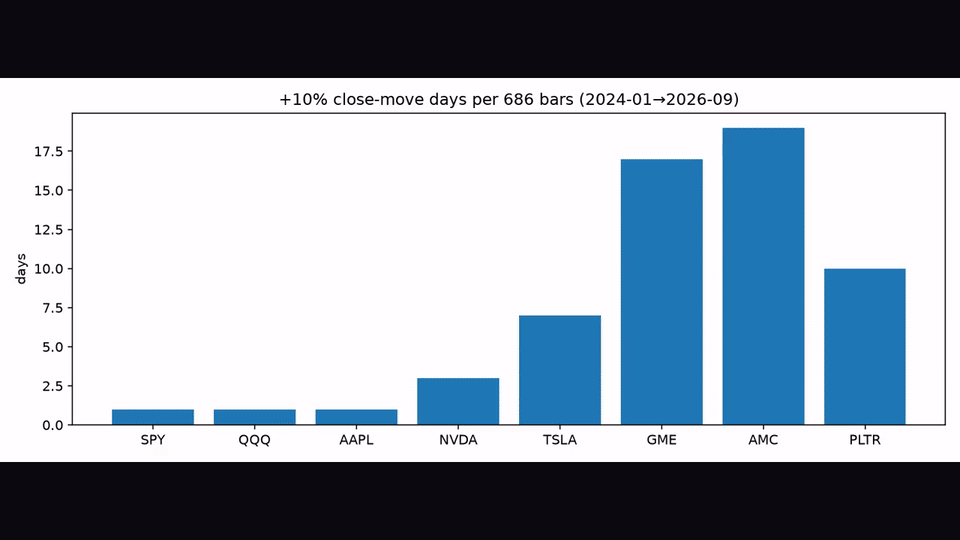
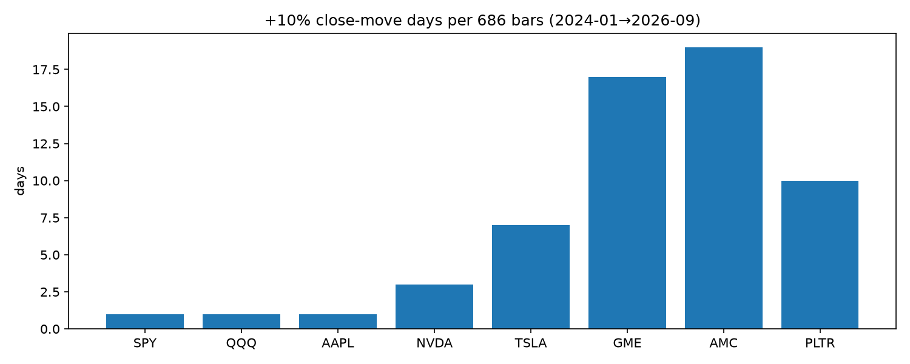
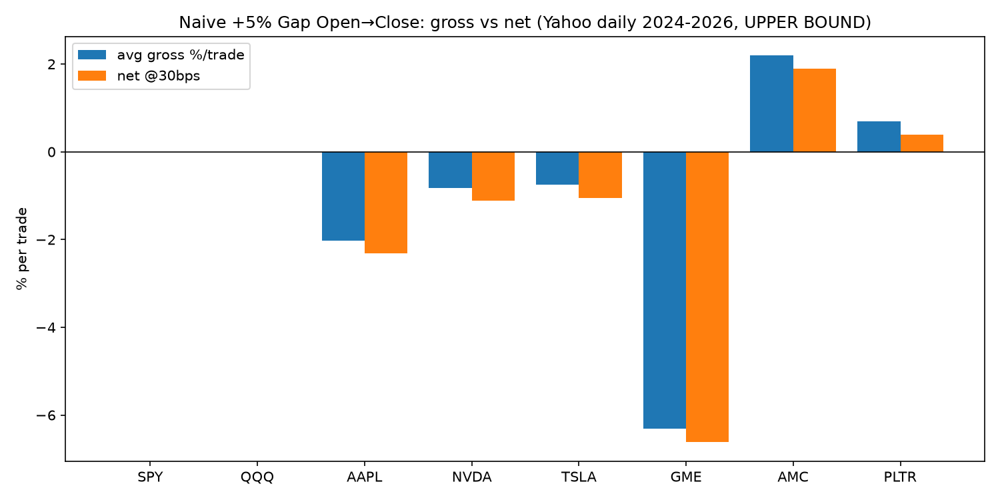
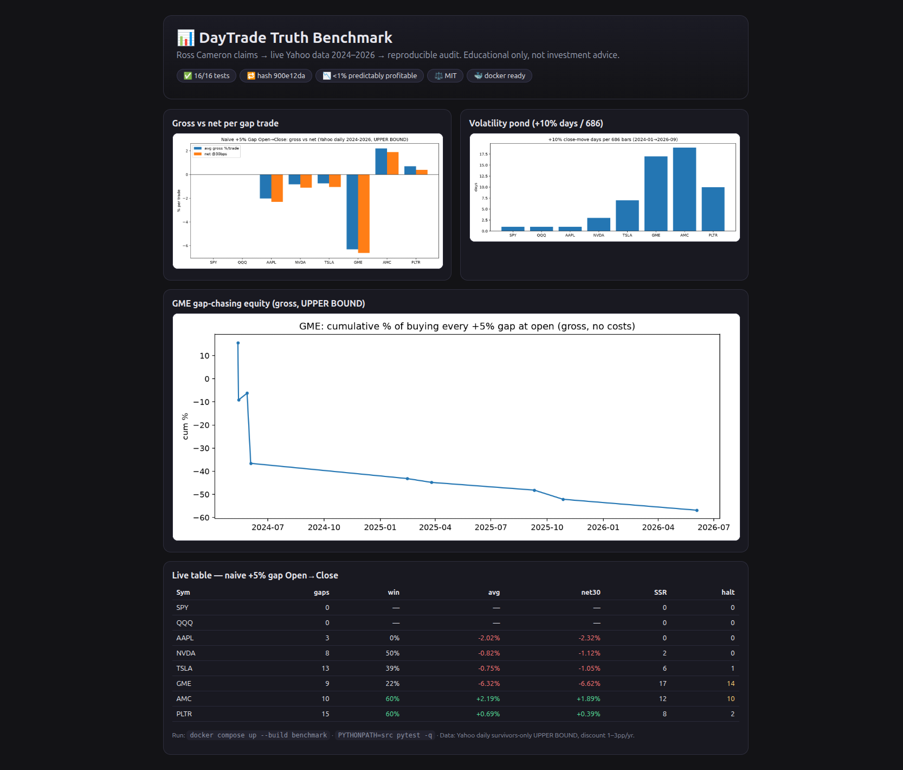

<p align="center">
  
</p>

<h1 align="center">DayTrade Truth Benchmark</h1>
<p align="center"><b>Ross Cameron claims → live 2024–2026 market data → PhD-ready reproducible audit.</b></p>

<p align="center">
  <a href="https://github.com/M0-AR/daytrade-truth-benchmark/actions/workflows/ci.yml"></a>
  
  
  
  
</p>
<p align="center">
  
  
  
</p>

<p align="center">
  <a href="#-quick-start">Quick Start</a> ·
  <a href="#-demo-video--screenshots">Demo</a> ·
  <a href="docs/00-zero-to-hero-roadmap.md">Roadmap</a> ·
  <a href="docs/06-real-data-verification.md">Live proof</a> ·
  <a href="CONTRIBUTING.md">Contributing</a>
</p>

> [!NOTE]
> Nothing here is asserted by hand without a verified 2026–2027 source. Every number maps to `docs/01-claims-verification-matrix.md` + `docs/05-search-audit-log.md` with URL, date, and vote. Educational research only — not investment advice.

## 🎬 Demo video + screenshots

[](https://www.youtube.com/watch?v=YOUR_VIDEO_ID)
<p align="center"><i>13s, 219KB GIF (8fps, 960px). MP4: <code>assets/demo.mp4</code>. Full loop: pond → gross-vs-net → GME equity → dashboard. Source: <code>docs/demo.tape</code> (VHS) + <code>scripts/record_demo.sh</code> (ffmpeg fallback). See <code>docs/DEMO.md</code> for YouTube publish steps.</i></p>

|  |  |
|---|---|
| +10% days / 686 bars: meme pond vs large-cap desert | Naive +5% gap Open→Close: gross vs net@30bps (UPPER BOUND) |


<p align="center"><i>Playwright full-page capture of <code>results/dashboard.html</code> (1666×1419, 2026-09-27). Re-capture: serve + <code>playwright_browser_navigate</code> → snapshot → <code>take_screenshot</code>.</i></p>

## ✨ Why this repo is different

| Feature | Detail |
|---|---|
| 🔬 Verified, not vibes | 11 Exa + SearXNG + DuckDuckGo + Jina searches, sequential (no 429), voted ✅/⚠️/❌ |
| 📈 Live data | 8 Yahoo tickers × 686 days (2024-01-02→2026-09-25), hashed `900e12da`, docker-reproduced |
| 🛡️ Executable guardrails | Cameron 20 + SSR Rule 201 + LULD + FINRA 2026 IML as code (`src/dtb/guardrails.py`) |
| 💸 Cost truth | 5/15/30/50/100bps arms; QuanterLab ladder; naive gaps go negative net |
| 🎓 PhD-ready | H1–H7, PIT/survivorship checklist, DSR/PBO gates, kill-log (`docs/03`+`04`) |
| 🐳 One command | `docker compose up --build benchmark` → 16 tests + both benchmarks |

## 🚀 Quick start

```bash
git clone https://github.com/M0-AR/daytrade-truth-benchmark.git
cd daytrade-truth-benchmark
docker compose up --build benchmark
# outputs: results/benchmark.json + results/real_benchmark.json (sha256 logged)
```

Local:

```bash
pip install -r requirements.txt
PYTHONPATH=src pytest -q            # 16 passed
PYTHONPATH=src python -m dtb.benchmark --out results/benchmark.json
PYTHONPATH=src python -m dtb.benchmark_real --out results/real_benchmark.json
python3 -m http.server 8000 &       # open results/dashboard.html
bash scripts/record_demo.sh         # re-render assets/demo.mp4 + demo.gif
```

## 📚 Table of contents

- [Demo](#-demo-video--screenshots) · [Why](#-key-verified-findings) · [Install](#-install) · [Usage](#-usage--cli) · [Repo map](#-repo-map) · [Live proof](#-live-proof-sep-2026) · [Roadmap](#-roadmap) · [Contributing](#-contributing) · [License](#-license)

## 🔑 Key verified findings (2026-09-27)

1. **Base rates brutal:** 70% US lose (Jordan & Diltz 2003), >80% Taiwan/6mo, 97% Brazil 300d+ (Chague 2020), <1% predictably profitable (Barber 2014).
2. **PDT $25k GONE:** FINRA 26-10 + SEC 34-105226, eff. 2026-06-04 → 2027-10-20. Now IML deficit + 90-day freeze. Book historically right, operationally obsolete.
3. **Cameron audit real, not replicable:** $583.15 (2017) → $18.8M Dec 2025 audited; FTC 2022 $3M = marketing (student earnings), not fake Ross trades.
4. **2:1 math exact:** breakeven `1/(1+R)` → 33.3% at 2R; expectancy `p·W−(1−p)·L`; 1% rule = survival, not edge.
5. **Gross vs net:** small-cap gross strongest, erased <$480M by 4.2× spreads + 1.8× turnover; Amihud persists; rotation > RVOL.
6. **Sim gap 20–40%:** paper 3–5× live; loss aversion 2.25×; bridge via constrained sim + 30–100 logs + micro-live.
7. **LIVE gaps lose:** GME −6.32% avg (22% win), TSLA/NVDA/AAPL negative; only AMC +2.19%→+1.89% net30, PLTR +0.69%→+0.39%. SSR 17/12d, halt-risk 14/10. UPPER BOUND.

Full votes: `docs/01-claims-verification-matrix.md`.

## 🛠️ Install

| Need | Command |
|---|---|
| Python | 3.12 (`requirements.txt`: numpy, pandas, pytest, yfinance, requests) |
| Docker | `docker compose up --build benchmark` (retries + `data/` baked in) |
| Video | `ffmpeg` preinstalled; optional `vhs` + `ttyd` for `docs/demo.tape` |
| Browser shots | Playwright MCP (`playwright_browser_navigate` + `take_screenshot`) |

## 💻 Usage / CLI

```bash
PYTHONPATH=src python -m dtb.benchmark --help
PYTHONPATH=src python -m dtb.benchmark_real --symbols SPY,GME,AMC --out results/real_benchmark.json
PYTHONPATH=src pytest -q -k "real or metrics or guardrails"
```

<details><summary>Python API</summary>

```python
from dtb.metrics import expectancy, breakeven_win_rate
from dtb.guardrails import TradeIntent, DayState, full_gate
from dtb.data_real import load_cached
expectancy(0.45, 200, 100)          # → 35.0
breakeven_win_rate(2.0)             # → 0.3333
ok, msgs = full_gate(TradeIntent("AAA",5.2,6.2,4.7,500,12,0.13,4.0,True,True), DayState(50), 25000, 250)
df = load_cached("GME")             # 686 live bars
```
</details>

## 🗂️ Repo map

```
assets/  dashboard.png demo.gif demo.mp4 gap_* volatility_* gme_* slide_*
docs/    00-roadmap 01-matrix 02-PDT→IML 03-protocol 04-PhD-outline 05-audit-log 06-real-data DEMO.md demo.tape
src/dtb/ metrics.py guardrails.py (+SSR/LULD/IML) scanner.py data_real.py benchmark.py benchmark_real.py
tests/   test_metrics/guardrails/scanner/real.py (16)
data/    8×686 Yahoo CSVs   results/ benchmark.json real_benchmark.json dashboard.html
papers/  REFERENCES.md (links only)   scripts/ record_demo.sh
.github/ ci.yml templates CODEOWNERS dependabot   LICENSE CONTRIBUTING CODE_OF_CONDUCT SECURITY SUPPORT CHANGELOG CITATION.cff
```

## 📉 Live proof (Sep 2026)

| Sym | gaps≥5% | win | avg gross | net@30 | SSR | halt≥20% |
|---|---|---|---|---|---|---|
| SPY/QQQ | 0 | — | — | — | 0 | 0 |
| AAPL | 3 | 0% | -2.02% | -2.32% | 0 | 0 |
| NVDA | 8 | 50% | -0.82% | -1.12% | 2 | 0 |
| TSLA | 13 | 39% | -0.75% | -1.05% | 6 | 1 |
| GME | 9 | 22% | -6.32% | -6.62% | 17 | 14 |
| AMC | 10 | 60% | +2.19% | +1.89% | 12 | 10 |
| PLTR | 15 | 60% | +0.69% | +0.39% | 8 | 2 |

Method: gap = Open vs prevClose; buy open → sell close; no intraday stops; survivors-only → UPPER BOUND, discount 1–3pp/yr. Re-run: `python -m dtb.benchmark_real`.

## 🗺️ Roadmap

- [x] 20 guardrails as code + live Yahoo proof + IML patch
- [ ] 1-min confirmation (HF Library) + news timestamps + PIT delists
- [ ] WFA + DSR/PBO trial registry + paper/live shadow parity
- [ ] YouTube `YOUR_VIDEO_ID` → replace placeholder + social preview

## 🤝 Contributing

See `CONTRIBUTING.md` (setup, tests, no-secrets rule, Conventional Commits). Be kind: `CODE_OF_CONDUCT.md`. Security: `SECURITY.md`. Support: `SUPPORT.md`.

## 📄 License

MIT — see [LICENSE](LICENSE). If you use this in a thesis, please cite via [CITATION.cff](CITATION.cff).

## 🙏 Acknowledgments

- Ross Cameron / Warrior Trading (book + audited statements under test)
- Barber, Chague, Jordan/Diltz, Garvey/Murphy, Amihud (base rates + microstructure)
- FINRA/SEC (26-10, 34-105226), QuanterLab, Alphanume, HF Data Library, Yahoo Finance (free data with caveats)
- README craft: mdkit, banger-readme, standard-readme; badges: shields.io; demos: charmbracelet/vhs, Playwright, ffmpeg
- Videos取代不了尽职调查 — demo shows tooling, not trading advice.

> [!WARNING]
> Educational research only. Most day traders lose money. Past (even audited) performance ≠ future results. Do not run live on this code.
